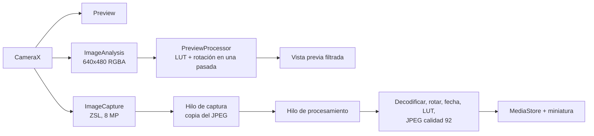

# Dusk

**Cámara para Android con estética de película**: filtros de color en vivo, fecha impresa estilo cámara analógica y disparo instantáneo. Pensada para sacar fotos rápidas de atardeceres caminando, con una interfaz minimalista.


Proyecto personal, desarrollado y probado en un **Moto G51 5G (Android 12)**.

---

## Capturas

<!-- Agregar capturas en docs/img/ y reemplazar los nombres -->
| Visor | Menú de opciones | Filtros |
|:---:|:---:|:---:|
|  |  |  |

---

## Características

### Cámara y captura
- **Zero-Shutter-Lag (ZSL)**: la foto se toma del cuadro más cercano al toque, sin esperar a que la cámara reaccione.
- **Dispara al apoyar el dedo**, no al soltarlo, y también con los **botones de volumen** (evita el temblor de tocar la pantalla).
- **Cola de procesamiento**: se puede sacar una foto tras otra; cada una se captura en el momento del toque y se procesa y guarda en segundo plano.
- **Flash** activable desde el visor.
- **Modo noche** (experimental): permite exposiciones más largas con poca luz, sin reiniciar la cámara.
- **Zoom** con pellizco (con límites del hardware) y un toque en el indicador para volver a 1.0x.
- **Enfoque táctil** con un anillo que confirma el resultado y desaparece solo; **mantener apretado bloquea enfoque y exposición** (AE/AF lock).
- **Exposición manual** con una barra que muestra el valor real en EV.
- Fotos de **8 MP** (4:3) guardadas en `Pictures/VintageCamera`, con la fecha real del disparo.

### Filtros de color en vivo
- Cuatro modos: **STD**, **FUJI 1**, **FUJI 2** y **B&W**.
- La vista previa muestra el filtro **en tiempo real**, y la foto final usa exactamente el mismo.
- Los filtros son **LUT 3D** en formato Hald CLUT (nivel 8, 512×512): agregar uno nuevo es copiar un PNG y sumar una línea de código.

### Fecha impresa
- Dígitos de **7 segmentos dibujados por código** (cápsulas redondeadas, leve inclinación, color ámbar), sin depender de ninguna fuente.
- Se dibuja **antes del filtro**, para que el color de la película la integre con el resto de la imagen.
- Siempre queda abajo a la derecha de la foto final, sin importar cómo se sostenga el celular.
- Botón de **mini calendario** para activarla o desactivarla; la elección se recuerda.

### Interfaz
- Diseño **minimalista** en negro cálido con un único acento ámbar, bordes redondeados y tipografía con espaciado.
- **Nivel de horizonte**: una línea fina de borde a borde que se pone ámbar al estar derecha (usa el sensor de gravedad y funciona con el celular acostado).
- **Cuadrícula** de composición (regla de tercios).
- **Menú de tres puntitos** con interruptores para horizonte, cuadrícula y modo noche.
- **Miniatura** de la última foto que abre la galería.
- Avisos breves en pantalla («Foto guardada») y parpadeo de obturador.
- **Pantalla de permiso** con acceso directo a los ajustes si se rechaza la cámara.
- Arranque en negro (sin destello blanco), ícono adaptativo con versión temática de Android 13+ y orientación fija en vertical (las fotos salen derechas igual).

### Acceso rápido
- **Tile de ajustes rápidos** para abrir la cámara desde el panel de notificaciones, incluso con el celular bloqueado.
- Con el celular bloqueado, la app **no muestra la última foto** ni abre la galería, para proteger la privacidad.

---

## Cómo funciona por dentro



### Vista previa filtrada
Un `ImageAnalysis` entrega cuadros de 640×480 en RGBA. `PreviewProcessor` aplica el LUT y la rotación **en una sola pasada** sobre arreglos reutilizados y publica el resultado como imagen sobre la vista previa. Para no gastar CPU, el análisis **se apaga en modo STD** y baja de 30 a 10 cuadros por segundo mientras se guarda una foto.

### LUT 3D
El filtro es una tabla de 64×64×64 colores guardada como imagen Hald de 512×512. El color de cada píxel se busca con operaciones de bits (6 bits por canal), sin objetos intermedios. En la foto final se procesa **en paralelo en varios hilos de baja prioridad**, para no quitarle CPU a la cámara.

### Pipeline de la foto
1. `ImageCapture` (ZSL) entrega el JPEG; se copia a memoria y se libera el cuadro de inmediato.
2. Un hilo de procesamiento decodifica el JPEG, lo rota, dibuja la fecha y aplica el LUT sobre el mismo bitmap (sin copias extra) para reducir el uso de memoria con fotos de 8 MP.
3. Se comprime a JPEG (calidad 92) y se guarda con `MediaStore` (`IS_PENDING` mientras se escribe, `DATE_TAKEN` con la hora real).
4. Se genera una miniatura de 192 px a partir del bitmap que ya está en memoria.

### Hilos
Tres ejecutores separados: **análisis**, **captura** y **procesamiento**. Sin esta separación, el trabajo del filtro en vivo retrasaba el disparo.

### Nivel de horizonte
Lee el sensor de gravedad (con el acelerómetro suavizado como alternativa), calcula la inclinación respecto al horizonte más cercano y la muestra con una línea que gira junto con el celular. Tiene histéresis para que no parpadee en el borde de «derecho».

---

## Decisiones técnicas

| Tema | Decisión | Motivo |
|---|---|---|
| Resolución | 8 MP (3264×2448) | El celular ofrece 12,5 MP solo como «alta resolución» (más lenta) y no expone los 50 MP del sensor a apps de terceros. Para la velocidad que se buscaba, 8 MP es el mejor equilibrio. |
| Fecha | Dibujada por código, no con una fuente | Permite imitar exactamente el estilo de las cámaras analógicas (segmentos redondeados), sin archivos ni licencias de fuentes. |
| Disparo | Al apoyar el dedo, no al soltar | Con ZSL, la foto sale de un cuadro anterior al toque, así que el movimiento de apretar todavía no la afecta. |
| Vibración | Después de capturar, no antes | El motor no mueve el celular durante la toma. |
| Interfaz | Un único archivo de composición, con componentes propios | Permite controlar cada detalle visual (menú, interruptores, íconos dibujados con `Canvas`) sin depender de un tema genérico. |

---

## Rendimiento (medido en Moto G51 5G)

- Tiempo entre foto y foto: **~450–600 ms** de procesamiento y guardado por imagen, en segundo plano.
- Con ráfagas largas, las fotos se encolan: cada una se **captura** en el momento exacto del toque y solo se demora su aparición en la galería.
- El proceso de optimización se hizo midiendo cada etapa (disparo, decodificado, rotación, fecha, filtro y guardado) y atacando primero la que más pesaba.

---

## Tecnologías

- **Kotlin** y **Jetpack Compose** (Material 3, componentes propios)
- **CameraX** (`camera-core`, `camera-camera2`, `camera-lifecycle`, `camera-view`) con interoperabilidad de Camera2
- **MediaStore** para guardar en la galería, sin permisos de almacenamiento
- **Sensores** (`SensorManager`) para el nivel de horizonte
- **TileService** para el tile de ajustes rápidos
- Gradle con **version catalog** (`libs.versions.toml`)

Requisitos: Android 10 (API 29) o superior. Desarrollado y probado en Android 12.

---

## Estructura del proyecto

```
app/src/main/
├── java/com/exe/vintagecameraapp/
│   ├── MainActivity.kt          Pantalla, componentes, captura, procesamiento y filtros
│   └── CameraTileService.kt     Tile de ajustes rápidos
├── assets/luts/                 Filtros LUT (Hald CLUT 512×512)
├── res/                         Ícono adaptativo, temas y recursos
└── AndroidManifest.xml
```

---

## Cómo compilar

1. Clonar el repositorio.
2. Abrir la carpeta con **Android Studio** y esperar la sincronización de Gradle.
3. Conectar un celular Android (API 29+) y ejecutar con **Run**.

### Agregar un filtro nuevo
1. Copiar el PNG Hald (512×512, nivel 8) a `app/src/main/assets/luts/`.
2. Agregar una entrada en `VintagePreset` dentro de `MainActivity.kt`, con su nombre y la ruta del archivo.

---

## Hoja de ruta

- [ ] Interpolación trilineal en los LUT (transiciones más suaves en degradados).
- [ ] Temporizador de 2 y 5 segundos.
- [ ] Guardar opcionalmente la original sin filtro.
- [ ] Grano de película opcional.
- [ ] Dividir `MainActivity.kt` en módulos (`lut/`, `camera/`, `ui/`).
- [ ] Pruebas automáticas del procesamiento de color.

---

## Créditos y licencias

<!-- Completar: origen y licencia de los LUTs en assets/luts/ -->

Ícono, interfaz y código de la aplicación: **@matiasquilo**.
